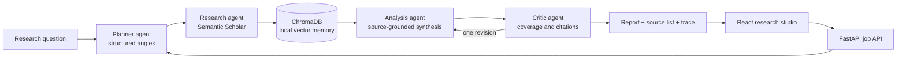

# Litera — Research, with receipts.

**An inspectable multi-agent research assistant that turns a research question into a source-grounded first-pass literature review.** Litera decomposes a question, searches real academic papers, retrieves relevant evidence, drafts a synthesis with inline citations, and gives a critic one bounded revision. The interface exposes the sources and run trace.

**Repository:** [github.com/xRONITx/litera-research-assistant](https://github.com/xRONITx/litera-research-assistant)

> This capstone project is a research aid, not a substitute for reading primary studies. The included sleep example is a clearly labeled demonstration. Live research requires your own free-tier model key. Evaluation is planned; no RAGAS scores or measured results are claimed yet.

## Product preview

Litera is a responsive React application with a FastAPI API. Try the example review in the interface without API credentials, or configure a model provider and run a live literature search.

## Features

- **Visible state graph:** planner → academic researcher → RAG-backed analyst → critic, with a single bounded revision edge.
- **Academic search:** Semantic Scholar's paper search API, returning paper metadata and abstracts.
- **Retrieval-augmented drafting:** abstracts are embedded and retrieved with ChromaDB's local embedding function when installed and available.
- **Citations from retrieved records:** bibliography metadata is sourced from returned papers; inline numeric citations link to those source records.
- **Provider adapter:** Gemini by default, Groq as a configured fallback, or local Ollama when explicitly enabled.
- **Inspectability:** background job status, visible run trace, paper list, error states, and health endpoint.
- **No paid service requirement:** designed for free tiers and local development. Free-tier availability and quotas are controlled by each provider and can change.

## Architecture



The workflow is implemented as a LangGraph state graph. FastAPI runs it as a background job. Job state currently lives in process memory; configure persistent storage before operating across restarts or multiple instances.

## Stack

| Layer | Technology |
|---|---|
| Frontend | React 18, TypeScript, Vite |
| API | FastAPI, Pydantic, Uvicorn |
| Orchestration | LangGraph |
| Academic search | Semantic Scholar Graph API |
| Vector retrieval | ChromaDB local client |
| Model providers | Gemini API, Groq API, optional Ollama |
| Hosting configuration | Vercel (frontend), Render (API), Docker |

## Run locally

### Requirements

- Node.js 20 or newer
- Python 3.11 or newer
- A free Gemini or Groq API key for live runs, or a local Ollama installation

### 1. Configure the API

```powershell
python -m venv .venv
.venv\Scripts\Activate.ps1
pip install -r requirements.txt
Copy-Item .env.example backend/.env
```

Add `GEMINI_API_KEY` to `backend/.env`. `GROQ_API_KEY` is optional and used if Gemini is rate-limited or unavailable. For local inference, set `LLM_PROVIDER=ollama` and set `OLLAMA_MODEL` to a model already pulled in Ollama.

Start FastAPI from the repository root:

```powershell
uvicorn backend.main:app --reload --port 8000
```

API docs: [http://localhost:8000/docs](http://localhost:8000/docs) · Health: [http://localhost:8000/health](http://localhost:8000/health)

### 2. Start the web app

In another terminal at the repository root:

```powershell
npm install
Copy-Item .env.example .env
npm run dev
```

Open [http://localhost:5173](http://localhost:5173). For live reports, use a sufficiently specific question. The API polls job status and retrieves the final report when ready.

## API

| Method | Route | Purpose |
|---|---|---|
| `GET` | `/health` | Health check |
| `POST` | `/query` | Start a background run; returns `job_id` |
| `GET` | `/status/{job_id}` | Read progress and trace |
| `GET` | `/report/{job_id}` | Fetch the completed report and sources |

Example:

```bash
curl -X POST http://localhost:8000/query \
  -H "Content-Type: application/json" \
  -d '{"question":"How does sleep quality affect academic performance in university students?"}'
```

## Deploy

### Frontend on Vercel

Import the repository into Vercel. The included `vercel.json` builds the Vite app. Set `VITE_API_URL` to the deployed API origin.

### API on Render

Create a Render Web Service from the repository and use the included `render.yaml`. Add `GEMINI_API_KEY` (and optionally `GROQ_API_KEY`) as secret environment variables. Set `CORS_ORIGINS` to the exact deployed frontend origin, with no trailing slash. Free instances can sleep when idle; the first request may be slow.

The API has in-memory job state and a local vector client, so a restart loses active jobs. For a persistent public deployment, add a durable job store and suitable persistent vector storage before relying on saved reports.

### Docker

```bash
docker build -t litera-web .
docker run --rm -p 8080:80 litera-web
```

Build the API separately with `docker build -f Dockerfile.backend -t litera-api .` and provide model keys through environment variables.

## Evaluation status

RAGAS evaluation is a planned project phase. A hand-built question set, references, baseline comparison, and measured faithfulness, answer relevance, and context precision scores have **not** been produced yet. Do not report sample or placeholder numbers as evaluation results. See [docs/evaluation.md](docs/evaluation.md) for the reporting template and next steps.

## Limitations

- Search results and abstracts depend on Semantic Scholar coverage and rate limits; not every paper has an abstract, DOI, or open full text.
- The current RAG layer indexes returned abstracts. It does not download or parse paywalled papers or user PDFs.
- A citation is linked to a retrieved paper record; this does not prove every adjacent sentence is supported by that paper.
- Model output can contain errors. The critic is a bounded review pass, not a guarantee of correctness.
- Job state is in memory; deployed instances can lose it on restart.
- No evaluation results exist yet.

## Roadmap

- [x] React research workspace and responsive review UI
- [x] FastAPI job/status/report endpoints
- [x] LangGraph planner, researcher, analyst, critic, and bounded revision
- [x] Semantic Scholar search and source-linked report
- [x] Gemini/Groq provider adapter and optional Ollama provider
- [ ] RAGAS dataset, baseline, and measured report
- [ ] Persistent job storage and saved review history
- [ ] PDF uploads and export formats
- [ ] Public deployment link and demo video

## Project status

This repository is a working capstone implementation in active development. The frontend sample is illustrative; live research is the real end-to-end pipeline. Deployment and measured evaluation remain to be completed.

## License

MIT. See [LICENSE](LICENSE).
