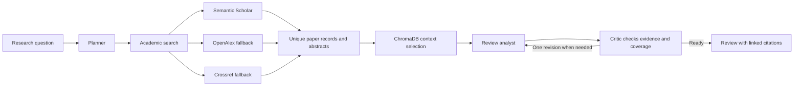

# Litera — Research, with receipts

**Litera turns a research question into a structured, source-linked literature review.** It is a chat-style research assistant for students and early researchers, with a multi-step workflow, academic-paper discovery, linked citations, and an interface that supports light, dark, and custom appearance settings.

| | |
|---|---|
| **Live website** | [xronitx.github.io/litera-research-assistant](https://xronitx.github.io/litera-research-assistant/) |
| **API health** | [litera-api-9rml.onrender.com/health](https://litera-api-9rml.onrender.com/health) |
| **GitHub repository** | [xRONITx/litera-research-assistant](https://github.com/xRONITx/litera-research-assistant) |

## Contents

- [What Litera does](#what-litera-does)
- [How a research run works](#how-a-research-run-works)
- [Technology](#technology)
- [Repository layout](#repository-layout)
- [Run Litera locally](#run-litera-locally)
- [Configuration reference](#configuration-reference)
- [API](#api)
- [Deployment](#deployment)
- [Data, security, and limitations](#data-security-and-limitations)
- [RAGAS evaluation](#ragas-evaluation)
- [License](#license)

## What Litera does

Submit a custom research question and Litera searches academic indexes, selects relevant paper records and abstracts, and drafts a literature review with numbered citations such as `[1]`. Citation markers link to a DOI or source page; the review also includes an expandable source list.

The production site supports account creation and sign-in through Supabase. Research history and appearance preferences are stored in the browser, grouped by signed-in account. A fixed sample review is available for demonstrations when a live search is unavailable.

### Features

- Custom questions entered in a responsive chat-style workspace.
- Multi-step research workflow built with LangGraph: question planning, paper discovery, evidence selection, synthesis, and a citation and coverage review.
- Academic discovery with Semantic Scholar, OpenAlex fallback, and Crossref fallback for low-result or unavailable primary searches.
- ChromaDB similarity retrieval over available paper abstracts, with a simple fallback if vector retrieval is unavailable.
- Inline numbered citations linked to DOI/source records and a complete source list with paper metadata.
- One bounded revision when the review step identifies a material issue.
- Gemini and Groq hosted model providers, with optional local Ollama support.
- Supabase email authentication and per-user access checks for API research jobs.
- Browser-local research history and a sample review for presentations.
- Appearance controls for system, light, and dark modes; accent and background/text colors; font family and text size. Preferences persist in the browser.

## How a research run works



The planner, analyst, and critic call the configured language-model provider. Academic search returns bibliographic records and abstracts when available; Litera does not fetch or analyze the full text of paywalled papers.

## Technology

| Layer | Technology | Role |
|---|---|---|
| Web interface | React 18, TypeScript, Vite | Single-page research workspace and appearance controls |
| UI components | Lucide React, React Markdown | Icons and formatted reviews with source links |
| API | FastAPI, Pydantic, HTTPX, Uvicorn | Validates requests, checks user sessions, and serves research jobs |
| Workflow orchestration | LangGraph | Coordinates planning, research, analysis, and review steps |
| Academic sources | Semantic Scholar, OpenAlex, Crossref | Search for paper metadata and abstracts with fallback paths |
| Context retrieval | ChromaDB | Ranks available abstracts for the review context |
| Language models | Gemini, Groq, optional Ollama | Plan searches, synthesize evidence, and review the draft |
| Quality evaluation | RAGAS, Google Gemini judge and embeddings | Score faithfulness, answer relevance, and context precision on a curated benchmark |
| Authentication | Supabase Auth | Email sign-up/sign-in and API bearer-token validation |
| Web hosting | GitHub Pages | Publishes the frontend from the `main` branch |
| API hosting | Render | Runs the FastAPI service defined by `render.yaml` |

## Repository layout

```text
.
├── backend/
│   └── main.py                 # FastAPI routes and LangGraph research workflow
├── docs/
│   └── evaluation.md           # Planned evaluation protocol and results template
├── src/
│   ├── App.tsx                 # Application, auth UI, research chat, and citations
│   ├── main.tsx                # React entry point
│   └── styles.css              # Responsive styles and theme palettes
├── .github/workflows/
│   ├── ci.yml                  # Frontend build and backend syntax checks
│   └── pages.yml               # GitHub Pages build and deployment
├── .env.example                # Frontend and backend configuration template
├── render.yaml                 # Render API Blueprint
├── requirements.txt            # Python dependencies
├── package.json                # Frontend dependencies and scripts
└── LICENSE                     # MIT License
```

## Run Litera locally

### Requirements

- Node.js 20 or later (Node.js 22 is used in CI).
- Python 3.12 (the Render Blueprint uses Python 3.12).
- A Gemini or Groq API key for live reviews, or a locally running Ollama model.
- Supabase credentials only if you want to test authentication locally.

### 1. Configure and start the API

From the repository root, create a Python environment and install the dependencies:

```powershell
py -3.12 -m venv .venv
.\.venv\Scripts\Activate.ps1
pip install -r requirements.txt
Copy-Item .env.example backend\.env
```

Edit `backend/.env` and add at least one model provider key. For example:

```dotenv
GEMINI_API_KEY=your-gemini-key
LLM_PROVIDER=gemini
```

Keep provider keys on the API server. Do not place them in a `VITE_` variable or commit them. Then start the API:

```powershell
uvicorn backend.main:app --reload --port 8000
```

The API health endpoint is [http://localhost:8000/health](http://localhost:8000/health); interactive API documentation is at [http://localhost:8000/docs](http://localhost:8000/docs).

### 2. Configure and start the frontend

In a second terminal at the repository root:

```powershell
npm ci
Copy-Item .env.example .env
npm run dev
```

Open [http://localhost:5173](http://localhost:5173). The template points `VITE_API_URL` to `http://localhost:8000`. With no Supabase configuration, local auth is disabled. To run live research, the API still needs a working model key and access to the academic search providers. The sample review does not require API credentials.

On macOS/Linux, activate the virtual environment with `source .venv/bin/activate` and copy the template with `cp .env.example backend/.env` / `cp .env.example .env`.

### Local sign-in

To enable Supabase locally, set `VITE_SUPABASE_URL`, `VITE_SUPABASE_ANON_KEY`, and `VITE_REQUIRE_AUTH=true` in the frontend `.env`. Set `SUPABASE_URL`, `SUPABASE_ANON_KEY`, and `REQUIRE_AUTH=true` in `backend/.env`. Add `http://localhost:5173` to Supabase Auth's allowed redirect URLs. The browser key must be the Supabase publishable/anon key; never use a service-role key in the frontend.

## Configuration reference

The repository's `.env.example` contains the main settings. The frontend reads `VITE_` values at build time; the API reads its settings at runtime.

### Frontend

| Variable | Purpose |
|---|---|
| `VITE_API_URL` | API origin. Defaults to `http://localhost:8000` during local development. |
| `VITE_SUPABASE_URL` | Supabase project URL used by the browser auth client. |
| `VITE_SUPABASE_ANON_KEY` | Public Supabase publishable/anon key. It is not a model secret. |
| `VITE_REQUIRE_AUTH` | Set to `true` to require sign-in in the interface. |

### Backend

| Variable | Purpose |
|---|---|
| `LLM_PROVIDER` | Preferred model provider: `gemini`, `groq`, or `ollama`. Configured providers are tried as fallbacks. |
| `GEMINI_API_KEY` | Private Gemini key. |
| `GEMINI_MODEL` | Gemini model name; defaults to `gemini-3.5-flash-lite` in the current code. |
| `GROQ_API_KEY` | Private Groq key. |
| `GROQ_MODEL` | Groq model name; defaults to `openai/gpt-oss-120b`. |
| `OLLAMA_ENABLED` | Set to `true` to include Ollama in provider fallback. |
| `OLLAMA_MODEL` | Local Ollama model; defaults to `llama3.1:8b`. |
| `OLLAMA_BASE_URL` | Ollama server origin; defaults to `http://localhost:11434`. |
| `SUPABASE_URL` | Supabase project URL used to validate bearer tokens. |
| `SUPABASE_ANON_KEY` | Supabase publishable/anon key used for token validation. |
| `REQUIRE_AUTH` | Set to `true` to require a valid Supabase session for research API routes. |
| `DAILY_RESEARCH_LIMIT` | Maximum accepted reviews per user in the API process's rolling 24-hour window; defaults to `3`. |
| `SEMANTIC_SCHOLAR_API_KEY` | Optional Semantic Scholar API key. |
| `OPENALEX_API_KEY` | Optional OpenAlex API key. |
| `CROSSREF_MAILTO` | Optional email address for the Crossref API's polite pool. |
| `CORS_ORIGINS` | Comma-separated allowed browser origins, without URL paths. |

## API

| Method | Route | Description |
|---|---|---|
| `GET` | `/` | API name and documentation path. |
| `GET` | `/health` | Service status and whether auth/model credentials are configured. |
| `POST` | `/query` | Start a review; accepts a question from 12 to 1,000 characters and returns a job ID. |
| `GET` | `/status/{job_id}` | Read progress for a job owned by the requesting user. |
| `GET` | `/report/{job_id}` | Fetch a completed report and its source records. |

When auth is enabled, send `Authorization: Bearer <supabase-access-token>` to the query, status, and report routes. Job status and reports are checked against the verified user ID.

Example local request when auth is disabled:

```bash
curl -X POST http://localhost:8000/query \
  -H "Content-Type: application/json" \
  -d '{"question":"How does sleep quality affect academic performance in university students?"}'
```

## Deployment

The project uses GitHub Pages for the frontend and Render for the API. The Pages workflow deploys on pushes to `main`; the Render Blueprint describes the API service and health check.

### GitHub Pages

1. Enable GitHub Pages with **GitHub Actions** as the deployment source.
2. In **Settings → Secrets and variables → Actions → Variables**, configure:

   | Variable | Example |
   |---|---|
   | `VITE_API_URL` | `https://your-api-service.onrender.com` |
   | `VITE_SUPABASE_URL` | `https://your-project.supabase.co` |
   | `VITE_SUPABASE_ANON_KEY` | Supabase publishable/anon key |
   | `VITE_REQUIRE_AUTH` | `true` |

3. Push to `main`, or run **Deploy site to GitHub Pages** from the Actions tab. These are build-time values. Only public browser configuration belongs in these variables.

### Render API

1. In Render, create a Blueprint from this repository and apply `render.yaml`.
2. Add private provider keys and the Supabase project URL/key to the API service's environment. Never add model keys to GitHub Pages variables or frontend build settings.
3. Confirm `REQUIRE_AUTH=true`, `DAILY_RESEARCH_LIMIT=3`, and `CORS_ORIGINS` includes the frontend's origin, for example `https://xronitx.github.io`.
4. Verify the service at `/health` and set the resulting API origin as `VITE_API_URL` in GitHub Actions variables.

### Supabase Auth

For a new deployment, set the Supabase Auth Site URL to the frontend URL and add the frontend URL and local development URL to the redirect allow list. The published app URL includes the repository path: `https://xronitx.github.io/litera-research-assistant/`.

The live Litera deployment linked above is already configured. Its Render free-tier instance may sleep while idle, delaying the first request. Provider free-tier availability and quotas can also change.

## Data, security, and limitations

- Gemini/Groq/Ollama credentials stay in the API environment. Supabase's publishable/anon key is intended for browser use; never expose a service-role key.
- Supabase is used for authentication and token validation. Research history is stored in the browser's local storage; it does not sync between devices or use a database in this project.
- API jobs, result reports, and the daily-limit counter are held in process memory. A service restart loses active jobs and resets that in-memory counter. Durable job storage and shared rate limiting are not implemented.
- Search uses bibliographic records and abstracts where available, not complete paper text. Some records have limited metadata or no abstract. DOI links may lead to publisher pages that require access.
- Litera's review is a research aid, not a systematic review or a substitute for checking the original sources. Verify the papers and claims before citing them.
- The sample review is fixed demonstration content; opening it does not perform a live search.
- Model and academic-index quotas can be reached, and free hosting can sleep or impose limits.

## RAGAS evaluation

Litera includes a live RAGAS benchmark with six curated research questions and references. It evaluates the deployed multi-agent API's faithfulness, answer relevance, and reference-based context precision. The evaluator records exact answers and retrieved contexts alongside per-case and aggregate scores, model/package versions, API revision, and limitations.

The benchmark runner is [`scripts/evaluate_ragas.py`](scripts/evaluate_ragas.py), with cases in [`evaluation/cases.jsonl`](evaluation/cases.jsonl) and the full protocol in [`docs/evaluation.md`](docs/evaluation.md). It uses Google Gemini as the judge and Gemini embeddings for answer relevance; evaluator credentials remain local and are never needed by the deployed product.

No measured scorecard is included yet because this workspace did not have a judge API key or authenticated API session configured. Run the benchmark after setting local `RAGAS_GOOGLE_API_KEY`, `LITERA_API_URL`, and (for authenticated APIs) `LITERA_ACCESS_TOKEN`:

```powershell
pip install -r requirements-evaluation.txt
python scripts/evaluate_ragas.py
```

The runner defaults to three cases to stay within the production API's three-review daily limit. It writes `evaluation/results/latest.json` and `evaluation/results/latest.md`, plus a privacy-conscious aggregate at `public/evaluation-scores.json` for the website. Commit and push that generated public score file to publish the scorecard in Litera's **Evaluation** view. Use `--limit 0` for all six cases only when the selected API has sufficient quota. These model-based scores are validation signals on a small curated set, not an accuracy guarantee or evidence of improvement over a baseline.

## License

Litera is released under the MIT License. See [`LICENSE`](LICENSE).
